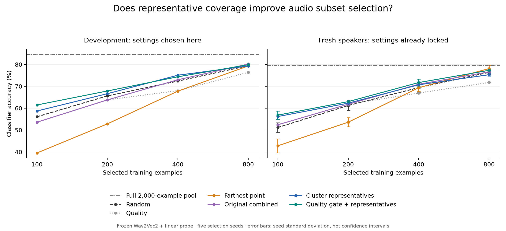

# A better low-budget baseline, with limits

Run date: 18 October 2026.

**Quality filtering followed by cluster representatives is more promising than the original weighted quality/diversity selector, especially at the smallest budget.** It outperformed random sampling in mean accuracy at all four budgets on a fresh speaker cohort. The evidence for improvement is strongest at budget 100; the larger-budget differences remain uncertain.

## Fresh confirmation results

Settings were chosen on the existing 500-example tuning validation set and locked before processing the confirmation cohort. Confirmation uses **372 previously unused official-validation recordings from 59 speakers absent from the training candidate pool and tuning set**. The previously inspected 4,074-recording test set was not opened.

| Training budget | Random | Original combined | Representatives | Quality filter + representatives | Filtered representatives minus random |
|---|---:|---:|---:|---:|---:|
| 100 | 51.18% | 52.42% | 56.18% | **56.83%** | +5.65 pp |
| 200 | 61.24% | 61.83% | 62.31% | **63.01%** | +1.77 pp |
| 400 | 69.41% | 70.97% | 70.70% | **71.72%** | +2.31 pp |
| 800 | 76.40% | 76.61% | 75.32% | **77.31%** | +0.91 pp |

Values average five selection seeds. The bold method is not the best of every strategy at every budget: pure farthest-point diversity reaches 78.12% at budget 800, though it performs very poorly at small budgets. Full details are in REPORT.md and summary.csv.

The full configured **2,000-example pool achieves 79.57%** on this cohort. Filtered representatives at budget 800 use 40% of those training examples and remain **2.26 percentage points below** the full-pool baseline. This does not achieve a within-one-point target, and it does not establish annotation or total compute savings.

These accuracies must not be directly compared with the previous 4,074-recording test accuracies: this is a different, smaller cohort with a different class/speaker mix.

## How certain are the differences?

Every locked classifier was refitted and its original confirmation accuracy reproduced exactly. A paired bootstrap resampled speakers with all their recordings, averaging correctness across the five locked seed models within each recording. There were 2,000 bootstrap replicates.

| Budget | Filtered representatives minus random | Exploratory 95% speaker-bootstrap interval |
|---|---:|---:|
| 100 | +5.65 pp | [+2.51, +8.79] pp |
| 200 | +1.77 pp | [-0.66, +4.35] pp |
| 400 | +2.31 pp | [-0.60, +4.90] pp |
| 800 | +0.91 pp | [-1.75, +3.68] pp |

The budget-100 result is a useful positive signal. These are exploratory, unadjusted intervals conditional on this training pool, tuning search, and cohort. They do not establish general superiority across datasets or account for multiple comparisons. No settings were changed after confirmation results were visible.

## What changed in the selection objective?

The original diversity selector deliberately chooses points far from existing selections. At small budgets this can spend scarce slots on isolated recordings.

The new representative selector instead fits class-wise KMeans and chooses a real recording near each occupied cluster centre. The filtered version removes a configurable lower-quality fraction first. It always preserves enough candidates to fill the class budget.

Validation chose retention fractions of **75%, 90%, 75%, and 75%** at budgets 100, 200, 400, and 800 respectively. These choices were made before confirmation. The quality score itself and its weights were unchanged.

At budget 100:

- Random's average nearest-selected cosine distance is 0.1414; representatives reduce it to 0.1111, about **21% better average geometric coverage**.
- Farthest-point selection's selected-sample 5-neighbour distance is 0.2146, versus random's 0.1080 and representatives' 0.1085. This supports the concern that farthest-point selection favours isolated examples in this embedding space.
- Farthest-point mean quality is 0.4195, versus random's 0.4817 and filtered representatives' 0.5137.

These are training-pool geometry diagnostics, not causal explanations. Better coverage alone is insufficient: unfiltered representatives still improve coverage by about 22% at budget 800 yet score below random on confirmation.

## What the quality validation found

The separate training-only study evaluated controlled corruptions on 100 class-balanced recordings and five speaker-disjoint classifier folds over all 2,000 candidates.

The existing score has some task relevance: the lowest quality quintile has 71.75% held-out accuracy, versus 88.50% in the highest quintile. However, the Spearman correlation between quality and held-out loss is only **-0.1398**, and individual components have problems:

- RMS stability correlates **+0.1883** with classifier loss, despite receiving a positive quality weight. This is an association, not proof that stability causes worse classification.
- Moderate clipping increases mean score by about **0.0030** relative to its gain-controlled clean reference; only 53% of those examples are penalized.
- Keeping only the first half of a recording increases mean score by **0.0171**, even though truncation can remove useful speech.
- Added 0 dB noise receives a higher mean score than 10 dB noise: **0.4362 versus 0.3813**. Noise severity is not ranked monotonically.
- Reducing gain to one quarter lowers mean score by **0.0317**, showing sensitivity to amplitude as well as recording damage.
- Silence is correctly assigned zero.

This supports using the current score cautiously as a coarse filter, rather than treating it as a calibrated quality ranking or fitting arbitrary new weights to the confirmation results. See ../quality_study_v3/REPORT.md for details.

## Implementation and verification

- Experimental selectors: experiments/representative.py.
- Study runner: scripts/study_representative_selection.py.
- Training-only quality study: scripts/study_quality_signals.py.
- Paired speaker-bootstrap analysis: scripts/analyze_confirmation_uncertainty.py.
- Exported PNG/SVG curves: scripts/plot_representative_study.py.
- Frozen v2 preparation code and original benchmark outputs remain unchanged.
- All train/tuning/confirmation speaker IDs and sample IDs are disjoint. Raw-byte audio hashing found zero confirmation content overlap with training or tuning.
- The comparison fitted **723 candidate heads**, then evaluated **121 locked heads** on confirmation. It took approximately **290 seconds**, including confirmation preparation, on this machine.
- Original confirmation accuracies were reproduced before uncertainty analysis.

The automated suite and protocol tests enforce exact budgets, unique exemplars, deterministic seeded selection, duplicate-vector handling, training-only selection, correct corruption noise levels, locking before confirmation, no test-split access, and paired bootstrap behavior.

Final verification: **70 tests passed; one dataset-download test skipped**. The only warning comes from the intentional sub-frame audio fixture used to check silence handling.

## Cost, novelty, and next work

At budget 800, filtered representative selection averages about **2.56 seconds**, plus 0.27 seconds for fitting the chosen head. Random selection takes about 0.019 seconds plus 0.31 seconds for its head; fitting the full-pool head takes about 0.35 seconds. This experiment therefore establishes no computational saving for the cheap linear classifier. The motivation would be saving expensive annotation or repeated model training, which still needs direct evaluation.

KMeans representatives and quality filtering are established building blocks; this experiment does not create an algorithmic novelty claim. The useful contribution so far is a reproducible finding: representative selection is a stronger small-budget baseline here, and the acoustic proxy's weaknesses can be measured rather than assumed away.

The next justified step is to freeze these methods and expand the candidate pool, followed by an independent task/dataset evaluation. Improve quality calibration using training-only or development evidence, with explicit noise/clipping/truncation constraints, before claiming a new metric. The confirmation cohort is now observed and should not become a tuning target. Retrieval/RAG remains a separate, unimplemented objective.

