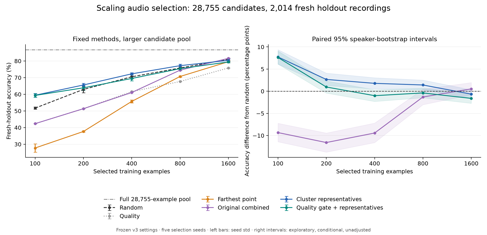

# Scaling result: representatives help at small budgets; the quality gate is fragile

Run date: 18 October 2026.

**Unfiltered cluster representatives retain a useful low-budget advantage when the candidate pool grows from 2,000 to 28,755 recordings. The earlier quality-filter advantage does not generalize consistently to this larger study.** No tested subset approaches full-pool accuracy within one percentage point.

## Scope and protocol

All **30,769 official-training recordings** in the ten configured Speech Commands classes were inventoried. A fixed seed reserved **250 speakers absent from the original 2,000-example candidate pool**, producing:

- **28,755 training candidates from 1,758 speakers**.
- **2,014 fresh holdout recordings from 250 speakers**.
- Zero train/holdout sample-ID, speaker-ID, or byte-identical content overlap.
- Zero holdout speaker overlap with the previously used training pool.

This is a newly reserved holdout from the official training corpus. It is not the official test split or an independent dataset. The previously inspected validation, test, and v3 confirmation recordings were not loaded for evaluation in this run. Scores must not be compared directly with those earlier cohorts.

All method and classifier settings transferred from the earlier v3 tuning choices. Budgets 100–800 used their earlier settings; budget 1,600 used the budget-800 settings. The full-pool head used the earlier C=10. There was no new parameter search. The full-pool reference is therefore a frozen-configuration reference, not a claim about the best achievable full-pool classifier.

The six selectors used five seeds at each of five budgets, plus one deterministic full-pool head: **151 fitted classifiers**. All were fitted and checkpointed before the fresh holdout was processed. Quality normalization fitted candidate training data only.

## Fresh holdout accuracy

| Selected recordings | Random | Original combined | Representatives | Quality-filtered representatives |
|---|---:|---:|---:|---:|
| 100 | 51.69% | 42.35% | **59.42%** | 59.30% |
| 200 | 62.92% | 51.34% | **65.58%** | 63.87% |
| 400 | 70.51% | 61.07% | **72.28%** | 69.50% |
| 800 | 75.78% | 74.48% | **77.19%** | 75.39% |
| 1,600 | 81.04% | **81.58%** | 80.39% | 79.42% |

The complete **28,755-recording candidate pool reaches 86.79% accuracy and 0.8674 macro-F1**. The best mean at budget 1,600 is the original combined selector at 81.58%, still **5.21 percentage points below** that reference. Budget 1,600 is 5.56% of the candidate pool; this is substantial recording-count reduction but does not meet an approximately full-pool-accuracy target.

The original diversity selector is especially weak at small budgets: 27.73% at budget 100. Pure quality selection also underperforms random at every tested budget. Complete results, seed variability, settings, and macro-F1 are in REPORT.md and summary.csv.

## Evidence relative to random

Paired speaker-cluster bootstrap intervals use 2,000 resamples, retaining all recordings from each sampled speaker. Correctness is averaged across the five locked seed models within each recording.

| Budget | Representatives minus random | Exploratory 95% speaker-bootstrap interval |
|---|---:|---:|
| 100 | +7.74 pp | [+6.11, +9.37] pp |
| 200 | +2.66 pp | [+1.30, +4.08] pp |
| 400 | +1.78 pp | [+0.55, +3.04] pp |
| 800 | +1.41 pp | [+0.36, +2.51] pp |
| 1,600 | -0.66 pp | [-1.57, +0.33] pp |

This supports representative selection as a stronger small-budget baseline under this experiment's conditions. The effect declines with budget. These intervals are conditional on this corpus, partition, frozen settings, and fitted seed models. They are exploratory and unadjusted for multiple comparisons, not evidence of superiority across independent datasets.

The quality-filtered variant is +7.62 points at budget 100, but is below random at budgets 400, 800, and 1,600. At budget 1,600 its difference is **-1.62 points**, with interval **[-2.73, -0.56]**. Its uniformly positive mean gains in the earlier small confirmation study did not persist here. We should not promote a fixed 75% quality gate as universally beneficial.

The original combined selector is +0.54 points at budget 1,600, with interval [-0.79, +1.95], so that mean advantage over random remains uncertain. Its much poorer small-budget scores expose the risk of relying heavily on the current quality proxy.

## Redundancy and representation

The training pool contains **507 byte-identical content groups**, involving 1,209 recordings and 702 redundant copies. No duplicate group has conflicting class labels. Duplicated recordings have higher mean quality proxy values (0.4862) than other recordings (0.4575), so quality ranking can favour redundant examples.

Pure quality selection includes an average of 7 redundant copies at budget 100 and 75 at budget 1,600. Representative selectors include zero byte-identical copies in the evaluated subsets. Random selects zero at budget 100 and an average of 3.8 at budget 1,600.

This helps explain one difference between selectors, but does not establish causality or explain the full accuracy gap: representatives also beat random when both contain zero byte-identical duplicates. A deduplicated-random control is a useful future ablation. It must be developed using training/development evidence, not tuned against this now-observed holdout.

Quality and combined selection also concentrate recordings among fewer speakers. At budget 100, pure quality uses 50 distinct speakers, random averages 95.6, and representatives average 90.4. This is a coverage diagnostic, not a demographic fairness claim.

## Cost and engineering progress

The data preparation now runs in resumable, hash-verified 500-recording chunks. Full-candidate normalization is applied only after fitting statistics across all candidate chunks. Chunk scores are provisional and should not be used as final selection scores.

Independent seeded jobs can execute in separate workers while preserving the frozen factories, seeds, settings, and checkpoint identity. Eighty completed sequential checkpoints were reused; 71 remaining jobs ran with four workers and two threads per worker. No method parameter changed during that scheduling adjustment.

Observed component times on this machine:

- Candidate preparation: **688.12 seconds**, reusing compatible earlier cache entries; this is not a cold-start benchmark.
- Fresh holdout preparation: **64.21 seconds**.
- Parallel execution of the remaining 71 jobs: **709.12 seconds**.
- Full-pool head fit: **46.24 seconds**.
- Budget-1,600 representative selection: mean **154.36 seconds**, followed by a 0.82-second head fit.
- Budget-1,600 filtered representative selection: mean **112.56 seconds**, followed by a 0.68-second head fit.

These are observed wall times with mixed sequential/concurrent execution and resource contention, not controlled algorithm-speed measurements. They establish no compute saving at matched accuracy for this cheap linear classifier. Preparation costs must also be included. Annotation savings remain unproven because the selectors use known class labels.

Final verification: **76 tests passed; one network-dependent dataset-download test skipped**. Checks cover interrupted preparation/resume, complete-candidate normalization, speaker/content partitioning, frozen-setting transfer, checkpoint compatibility, and fitting all jobs before holdout access. Input hashes, metadata/index order, finite/unit-normalized embeddings, and the training-only normalization extrema were verified on the generated artifacts.

## What this changes

The project now has a large-pool, fresh-speaker scaling result, not just a 2,000-candidate demonstration. The defensible current finding is **representative coverage helps at small budgets on this task**. A quality gate is a hypothesis requiring calibration and task-specific validation, not an established improvement. Clustering/filtering remain standard building blocks; an algorithmic novelty claim has not been established.

Next, freeze these results and evaluate the same predefined methods on an independent dataset/task, including a deduplicated-random control and explicit cost objectives. Larger-budget curves or expensive-model training would be needed to establish near-full-pool performance or practical compute savings. Do not tune new quality weights, retention fractions, or clustering choices against this holdout. Retrieval/RAG and a user-facing application remain separate unfinished work.

